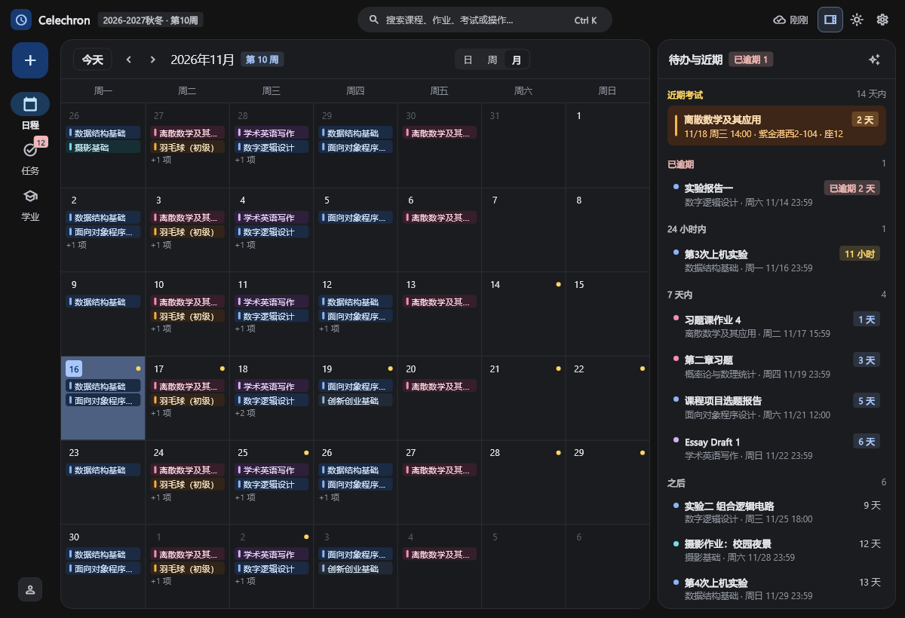
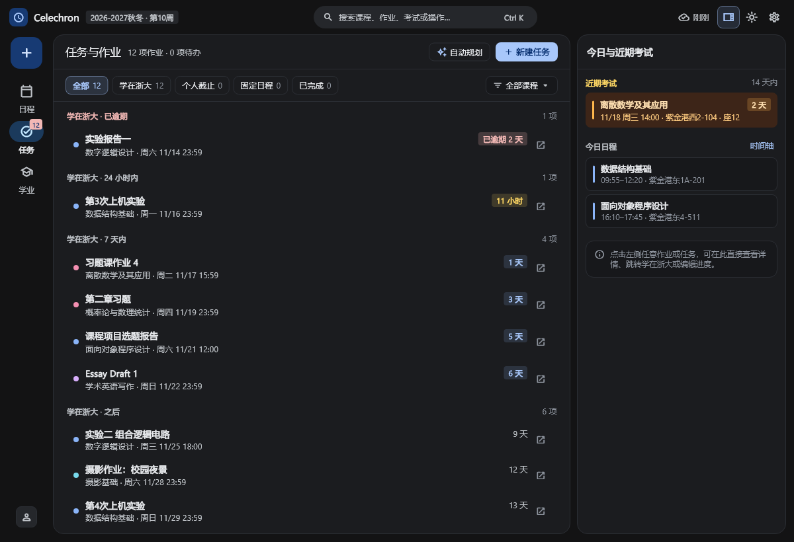
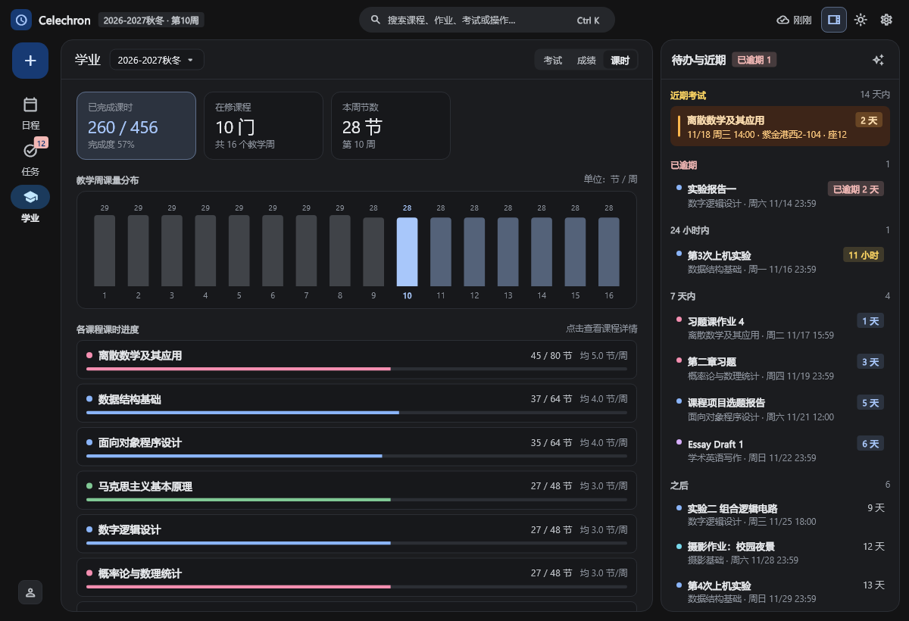
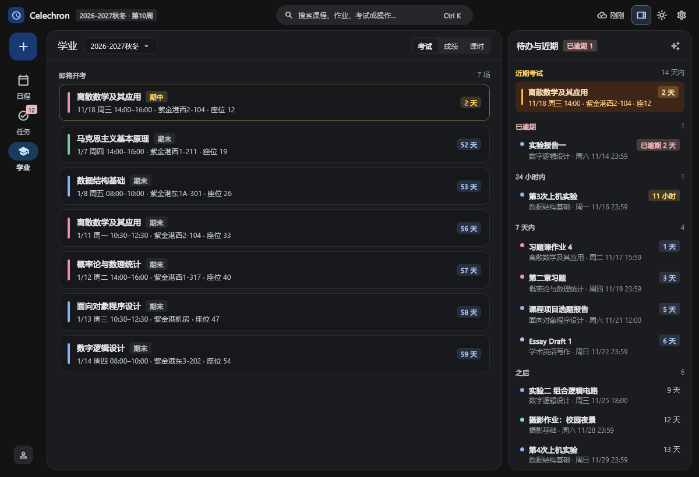

# Celechron 桌面版

**浙大课表、成绩、考试、学在浙大作业，在电脑上一个窗口看完。**

这是 [Celechron](https://github.com/Celechron/Celechron) 的非官方桌面版（Windows / macOS）：登录与数据抓取沿用原版，桌面前端基于 Material 3 与 Google Workspace 信息架构从零重构，严格按真实时间比例排布日程。

**[⬇ 前往最新 Release](../../releases/latest)** · [Windows 安装包 (`.exe`)](https://github.com/8eoyw/Celechron/releases/latest/download/Celechron-Setup-x64.exe) · [Windows 便携版 (`.zip`)](https://github.com/8eoyw/Celechron/releases/latest/download/Celechron-Windows-x64.zip) · [macOS (`.dmg`)](https://github.com/8eoyw/Celechron/releases/latest/download/Celechron-macOS.dmg)

<picture>
  <source media="(prefers-color-scheme: dark)" srcset="docs/screenshots/overview-dark.png">
  
</picture>

<sub>截图中的课程、成绩、考试与作业均为虚构的演示数据。</sub>

## 下载即用

到 [Releases](../../releases/latest) 或点击上方直链下载对应系统的文件，打开后使用统一身份认证（ZJUAM）学号和密码登录，课表、成绩、考试与作业会自动同步。

### Windows

下载 **[`Celechron-Setup-x64.exe`](https://github.com/8eoyw/Celechron/releases/latest/download/Celechron-Setup-x64.exe)**，双击安装。不需要管理员权限，也不用另装 VC++ 运行库。

> 第一次运行如果弹出「Windows 已保护你的电脑」，点 **更多信息 → 仍要运行**。这是因为程序没有付费的代码签名，源码全部公开在本仓库。
>
> 不想安装？下载 [`Celechron-Windows-x64.zip`](https://github.com/8eoyw/Celechron/releases/latest/download/Celechron-Windows-x64.zip)，**先解压**再运行里面的 `Celechron.exe`（直接在压缩包里双击会打不开）。

### macOS

下载 **[`Celechron-macOS.dmg`](https://github.com/8eoyw/Celechron/releases/latest/download/Celechron-macOS.dmg)**（或便携包 [`Celechron-macOS.zip`](https://github.com/8eoyw/Celechron/releases/latest/download/Celechron-macOS.zip)），打开后把 Celechron 拖进「应用程序」文件夹。同一个文件同时支持 Intel 与 Apple 芯片。

程序没有 Apple 付费签名，第一次打开会被系统拦下：

1. 双击打开一次，看到「无法打开」的提示后点「完成」；
2. 打开「系统设置 → 隐私与安全性」，拉到底部，点 Celechron 旁的 **「仍要打开」**，输入开机密码确认。

如果提示「已损坏，无法打开」，打开「终端」执行下面这行命令去掉隔离标记后再打开即可：

```bash
xattr -cr /Applications/Celechron.app
```

## 界面一览（v4 架构）

桌面端采用极简三工作区导航（**日程 / 任务 / 学业**）＋ **右侧协作面板** ＋ **`Ctrl+K` 全局指令搜索**：

### 日程：严格按时间比例的日 / 周 / 月视图

- **单日 / 宽屏双日时间轴**：所有课程、考试、自建日程与自动规划块按统一 `px/min` 线性比例渲染，不压缩午休；左侧同步显示钟点与浙大 **1–13 节次刻度**，宽屏（≥1480px）自动并排展开今日＋明日；空闲时段可直接点 `+ 规划` 或双击空白时段新建日程。
- **跨模块课程详情**：单击任意课程块，右侧协作面板原地切换为「课程详情」，一站汇总教师、学分、本学期课时进度、关联作业与期末考座号。


- **周视图与月视图**：7 天严格等比例周课表，撞课自动并排，节假日与调休清晰标注；月视图一屏总览整月排课与截止提醒。

<picture>
  <source media="(prefers-color-scheme: dark)" srcset="docs/screenshots/timetable-week-dark.png">
  
</picture>



### 任务与作业：学在浙大 + 个人任务 + 自动规划

将学在浙大待交作业（按「已逾期 / 24 小时内 / 7 天内 / 之后」分组，支持按课程筛选、右键复制标题与一键跳转网页）、个人截止任务、固定重复日程与 **自动规划** 收敛到同一工作台；停留在此页面时，右侧协作面板自动切换为「今日日程与近期考试」，避免重复展示。



### 学业：考试、成绩与 16 周课时统计

共享学期切换器，一次覆盖 **考试安排与倒计时**、**GPA 与成绩明细（支持一键隐私隐藏绩点）** 以及 **16 周课量柱状图与各课程课时进度**。






### 键盘与鼠标

| 操作 | 快捷键 |
|---|---|
| 全局搜索与命令面板（课程 / 作业 / 考试 / 任务 / 操作） | `Ctrl` + `K`（macOS 为 `⌘` + `K`） |
| 展开 / 收起右侧协作面板 | `Ctrl` + `\`（macOS 为 `⌘` + `\`） |
| 切换工作区（日程 / 任务 / 学业） | `Ctrl` + `1` ~ `3`（macOS 为 `⌘` + `1` ~ `3`） |
| 回到今天 | `T` |
| 新建任务或固定日程 | `N` |
| 立即同步数据 | `Ctrl` + `R`（macOS 为 `⌘` + `R`） |
| 返回待办 / 关闭弹窗 | `Esc` |
| 查看课程或项目详情 | 单击 |
| 在空白时段快速添加日程 | 双击时间轴空白处 |
| 作业 / 任务操作菜单 | 右键 |

## 安全与隐私

- 账号密码**只保存在你自己的电脑上**（Windows 加密存储 / macOS 钥匙串），登录时只发送给学校统一身份认证。
- 除学校系统外，程序只访问 Celechron 官方配置服务获取校历与版本信息，不上传任何个人信息。
- 代码完全开源，可自行检查或编译。

## 和官方 Celechron 的关系

- 本仓库是 [Celechron/Celechron](https://github.com/Celechron/Celechron) 的分支，数据层与官方共用，感谢原作者们的工作。
- 桌面版是**非官方**版本，问题请在[本仓库 Issues](../../issues) 反馈，不要打扰原作者。
- 手机端请继续使用官方 iOS / Android 版。
- 课表因教务网限频（921）变空的修复已提交给官方：[Celechron#186](https://github.com/Celechron/Celechron/pull/186)。

## 已知限制

- 主要在本科生账号上测试，研究生账号尚未完整测试，欢迎反馈。
- 「同步到系统日历」在桌面版不可用。
- macOS 版在 Apple 芯片实测可用，Intel 芯片 Mac 欢迎反馈。
- 暂无自动更新，新版本发布在 [Releases](../../releases)。

<details>
<summary><b>从源码编译</b></summary>

需要：

- Flutter 3.x
- Visual Studio 2022，勾选「使用 C++ 的桌面开发」工作负载，并**额外勾选 C++ ATL 组件**（`flutter_secure_storage` 需要）

```bash
flutter pub get
flutter build windows --release -t lib/main_desktop.dart
```

产物在 `build/windows/x64/runner/Release/`，VC++ 运行库会一并打包进去，整个文件夹拷到其他电脑即可运行。

macOS 需要 Xcode 与 CocoaPods：

```bash
flutter build macos --release -t lib/main_desktop.dart
```

也可以直接在本仓库的 Actions 里运行 **Build macOS desktop**，会产出 `.dmg` 与 `.zip`；发布 Release 时会自动附加上去。

Windows 打安装包需要 [Inno Setup 6](https://jrsoftware.org/isinfo.php)：

```bash
ISCC.exe /DAppVersion=1.3.1-desktop.3 windows/installer/celechron.iss
```

代码结构：

- 桌面界面在 `lib/desktop/`
- 离屏布局检查：`flutter test test_desktop/layout_probe_test.dart`
- 比例时间轴验证：`flutter test test_desktop/today_timeline_test.dart`
- 用虚构数据生成 README 截图：`flutter test test_desktop/showcase_test.dart`

</details>

## 许可证

[GPL-3.0](LICENSE)，与官方 Celechron 相同。
