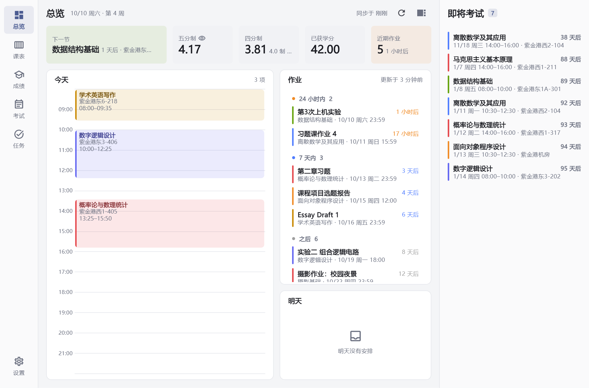
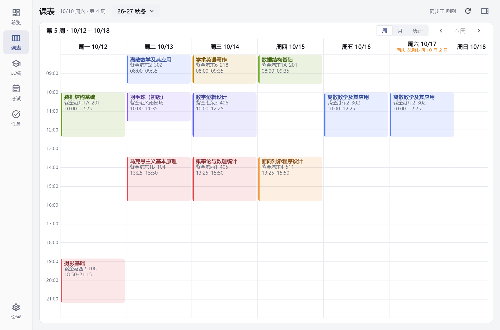
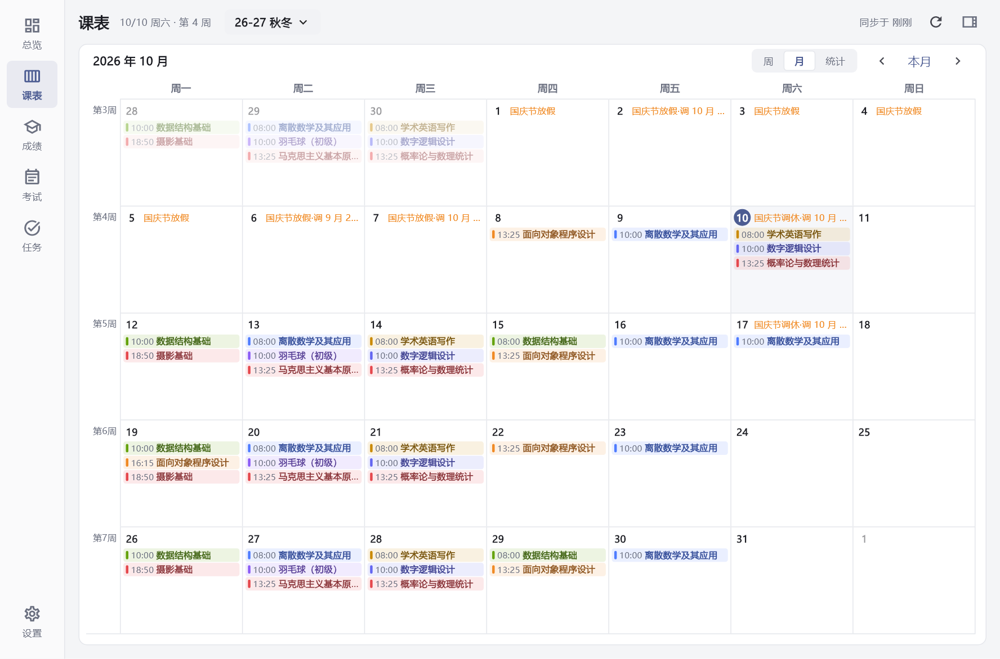
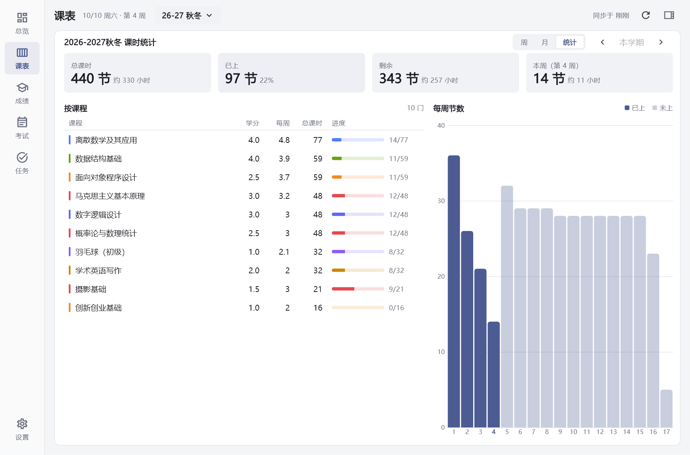
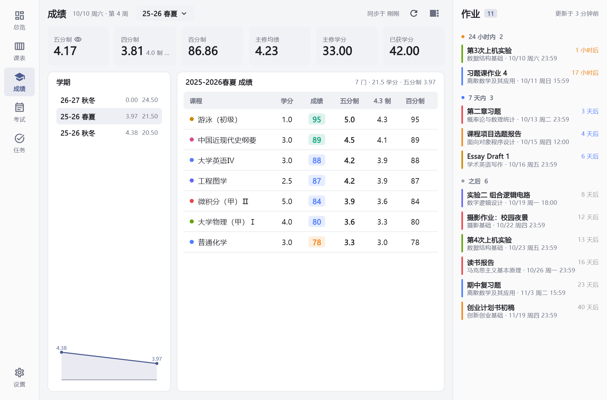
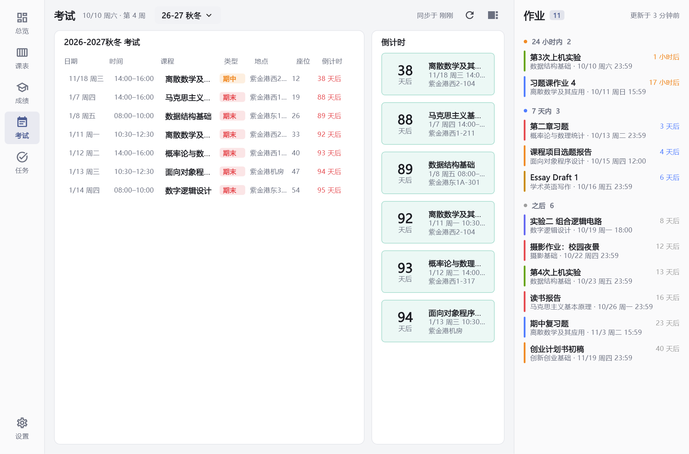
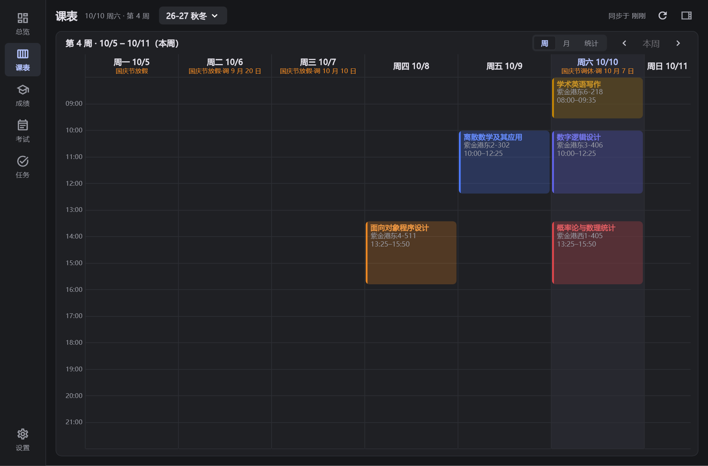

# Celechron 桌面版

**浙大课表、成绩、考试、学在浙大作业，在电脑上一个窗口看完。**

这是 [Celechron](https://github.com/Celechron/Celechron) 的非官方 Windows 版：登录和数据抓取沿用原版，界面为鼠标和大屏重新设计。

**[⬇ 下载安装包](../../releases/latest)** · Windows 10 / 11 64 位 · 免费开源

<picture>
  <source media="(prefers-color-scheme: dark)" srcset="docs/screenshots/overview-dark.png">
  
</picture>

<sub>截图中的课程、成绩、作业均为虚构的演示数据。</sub>

## 下载即用

1. 到 [Releases](../../releases/latest) 下载 **`Celechron-Setup-x64.exe`**，双击安装。不需要管理员权限，也不用另装任何运行库。
2. 打开后用统一身份认证的学号和密码登录。课表、成绩、考试、作业会自动同步。

> 第一次运行如果弹出「Windows 已保护你的电脑」，点 **更多信息 → 仍要运行**。这是因为程序没有付费的代码签名，不是病毒，源码都在这个仓库里。
>
> 不想安装？下载 `Celechron-Windows-x64.zip`，**先解压**再运行里面的 `Celechron.exe`（直接在压缩包里双击会打不开）。

## 界面一览

### 总览：打开就知道今天要干什么

下一节课在哪、今天的时间轴、7 天内要交的作业、明天的安排，都在第一屏。右侧栏列出所有即将到来的考试和倒计时。

### 课表：周、月、课时统计三种看法

**周视图**按真实时间排列，撞课的并排显示，节假日和调休日都有标注。



**月视图**一屏看完一个月，左侧标教学周，点任意一天跳到那一周。



**课时统计**：这学期一共多少节课、上了多少、还剩多少，每门课的进度，以及每周节数的柱状图。节数按学校的节次时间表计算，跨晚饭的长课不会多算。



顶栏可以切换学期，往年的课表随时翻回去看。

### 成绩

各学期绩点（五分制、4.3 制、百分制）、主修绩点、已获学分、单科成绩和绩点走势。绩点可以一键隐藏，在图书馆打开也不怕被看到。



### 考试

本学期所有考试的时间、地点、类型，右侧按倒计时排列。



### 作业与任务

- **作业**：直接拉取学在浙大的待交作业，按「24 小时内 / 7 天内 / 之后」分组，常驻在右侧栏，可以收起。
- **任务**：自己添加 DDL 和日程，自动排出学习时间；右键可以标记完成或删除。

### 深色模式

跟随系统，也可以在设置里手动切换。



### 键盘与鼠标

| 操作 | 快捷键 |
|---|---|
| 切换页面（总览 / 课表 / 成绩 / 考试 / 任务 / 设置） | `Ctrl` + `1` ~ `6` |
| 刷新数据 | `F5` 或 `Ctrl` + `R` |
| 查看课程 / 考试详情 | 单击 |
| 任务操作菜单 | 右键 |

## 安全与隐私

- 账号密码**只保存在你自己的电脑上**（使用 Windows 的加密存储），登录时只发送给学校的统一身份认证。
- 除了学校的系统，程序只访问 Celechron 官方服务器，用来获取校历配置和检查更新，不上传任何个人信息。
- 没有任何第三方服务器，作者拿不到你的数据。代码完全开源，可以自己检查或编译。

## 和官方 Celechron 的关系

- 本仓库是 [Celechron/Celechron](https://github.com/Celechron/Celechron) 的分支，数据层与官方共用。感谢原作者们的工作！
- 桌面版是**非官方**版本，有问题请在[本仓库的 Issues](../../issues) 反馈，不要打扰原作者。
- 手机上请继续用官方的 iOS / Android 版。
- 课表因教务网限频（921）变空的修复已经提交给官方：[Celechron#186](https://github.com/Celechron/Celechron/pull/186)。

## 已知限制

- 只在本科生账号上测试过，研究生账号未测试，欢迎反馈。
- 「同步到系统日历」在 Windows 上不可用。
- 暂无自动更新，新版本发布在 [Releases](../../releases)。

<details>
<summary><b>从源码编译</b></summary>

需要：

- Flutter 3.x
- Visual Studio 2022，勾选「使用 C++ 的桌面开发」工作负载，并**额外勾选 C++ ATL 组件**（`flutter_secure_storage` 需要）

```bash
flutter pub get
flutter build windows --release -t lib/main_desktop.dart
```

产物在 `build/windows/x64/runner/Release/`，VC++ 运行库会自动一起复制进去，整个文件夹拷到别的电脑就能运行。

打安装包需要 [Inno Setup 6](https://jrsoftware.org/isinfo.php)：

```bash
ISCC.exe /DAppVersion=1.3.1-desktop.2 windows/installer/celechron.iss
```

代码结构：

- 桌面界面在 `lib/desktop/`，设计说明见 `lib/desktop/DESIGN.md`
- 离屏布局检查：`flutter test test_desktop/layout_probe_test.dart`
- 用虚构数据生成 README 截图：`flutter test test_desktop/showcase_test.dart`

</details>

## 许可证

[GPL-3.0](LICENSE)，与官方 Celechron 相同。
