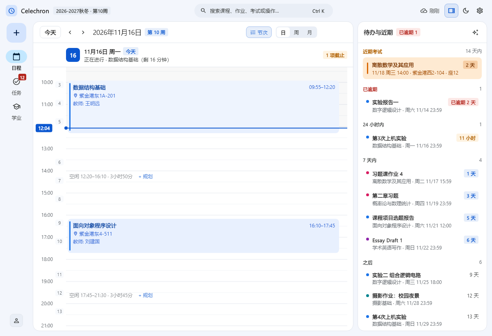
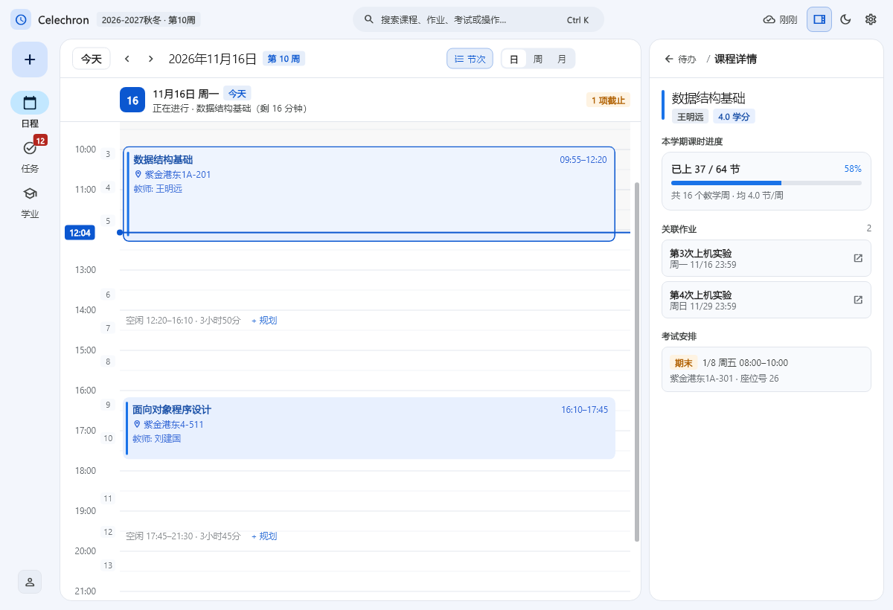
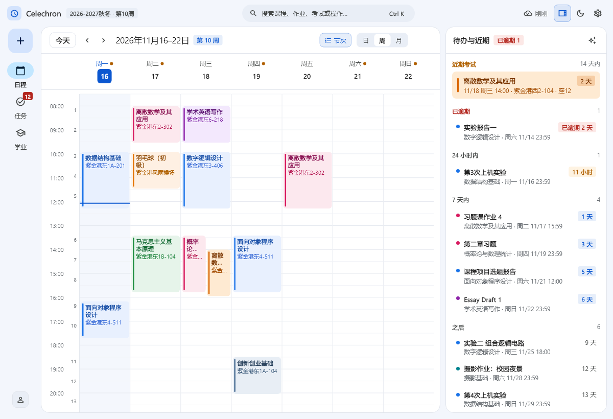
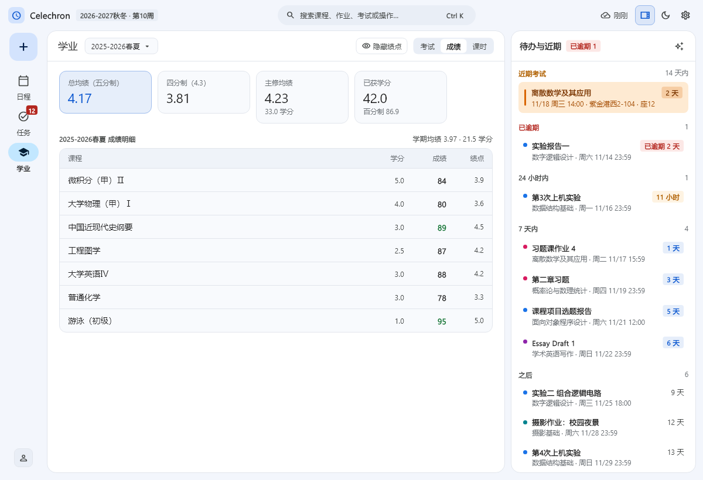

# Celechron 桌面版（Windows / macOS）

**Windows 和 macOS 都能用的浙大课表桌面端。** 基于 Celechron 移植，登录和抓取沿用原版，界面照着电脑键鼠习惯重新写了一遍。

**[下载最新版](../../releases/latest)** · [Windows 安装包 (`.exe`)](https://github.com/8eoyw/Celechron/releases/latest/download/Celechron-Setup-x64.exe) · [Windows 便携版 (`.zip`)](https://github.com/8eoyw/Celechron/releases/latest/download/Celechron-Windows-x64.zip) · [macOS (`.dmg`)](https://github.com/8eoyw/Celechron/releases/latest/download/Celechron-macOS.dmg)



<sub>截图使用虚构演示数据，仅校历为真实结构。</sub>

## 主要改了什么

- **Windows & macOS 原生运行，键鼠交互重写**：支持 `Ctrl+K`（macOS `⌘+K`）搜课程/作业/考试、双击空白时段建日程、右键菜单、`Ctrl+1~3` 切页面，也支持深色模式。
- **点课程直接看考试、作业、成绩和课时**：在课表、成绩或课时里点任意一门课，右边直接展开老师、学分、课时进度、关联作业、考场座号和已出成绩，按 `Esc` 退回待办，不用来回切页。



- **点作业直接跳学在浙大**：右侧挂着近期考试和按截止时间分组的作业；双击（或右键/点详情按钮）直接用浏览器打开学在浙大对应那次作业的页面，不用进首页一层层翻。


- **课表按实际时长排**：日/周/月三视图，午休不压扁，左边标 1–13 节次，窗口拉宽自动并排显示今明两天，**冲突选课**自动并排显示不遮挡。



- **同步更快更稳 + 防社死小功能**：去掉了桌面用不上的请求，挂代理时也会优先走校内直连、失败再自动切代理，**同步成功率更高**，减少一直转圈或教务网限频把课表刷空（[Celechron#186](https://github.com/Celechron/Celechron/pull/186)）。成绩页右上角带一键「隐藏绩点」，在图书馆开着不怕被看到。



## 快捷键

| 操作 | 快捷键 |
|---|---|
| 全局搜索（课程 / 作业 / 考试 / 任务） | `Ctrl+K`（macOS `⌘+K`） |
| 切换 日程 / 任务 / 学业 | `Ctrl+1` ~ `3` |
| 收放右侧栏 | `Ctrl+\` |
| 回到今天 / 新建任务 | `T` / `N` |
| 立即同步 | `Ctrl+R` |
| 退出详情 / 关闭弹窗 | `Esc` |

## 下载与打开（Windows & macOS）

使用统一身份认证（ZJUAM）学号和密码登录。

- **Windows（10 / 11 64 位）**：下 [`Celechron-Setup-x64.exe`](https://github.com/8eoyw/Celechron/releases/latest/download/Celechron-Setup-x64.exe) 直接装，不用管理员权限，也不用装运行库；免安装版 [`Celechron-Windows-x64.zip`](https://github.com/8eoyw/Celechron/releases/latest/download/Celechron-Windows-x64.zip) 需**先解压**再运行 `Celechron.exe`。没买代码签名，弹「Windows 已保护你的电脑」点 **更多信息 → 仍要运行**。
- **macOS（10.15+，Intel / Apple 芯片通用）**：下 [`Celechron-macOS.dmg`](https://github.com/8eoyw/Celechron/releases/latest/download/Celechron-macOS.dmg) 拖进「应用程序」。没买 Apple 签名，首次被拦后到「系统设置 → 隐私与安全性」点 **仍要打开**；若提示「已损坏」，在终端跑一行 `xattr -cr /Applications/Celechron.app`。

## 安全说明

纯本地客户端，没有自己的服务器。账密只存在本机系统加密存储 / macOS 钥匙串里，直连学校系统，源码全公开。

<details>
<summary>从源码编译</summary>

需要 Flutter 3.x；Windows 编译另需 Visual Studio 2022（「使用 C++ 的桌面开发」+ C++ ATL 组件），macOS 需 Xcode 与 CocoaPods。

```bash
flutter pub get
flutter build windows --release -t lib/main_desktop.dart
# 或 macOS:
flutter build macos --release -t lib/main_desktop.dart
```

桌面代码在 `lib/desktop/`，演示截图可用 `flutter test test_desktop/showcase_test.dart` 生成。

</details>

## 致谢与许可证

本项目基于开源项目 [Celechron/Celechron](https://github.com/Celechron/Celechron)（[GPL-3.0](LICENSE)），感谢原作者 [nosig](https://github.com/nosig) 及所有贡献者的工作。这是非官方桌面分支，桌面版问题请在 [Issues](../../issues) 反馈，不要打扰原作者；手机端请继续使用官方版。
