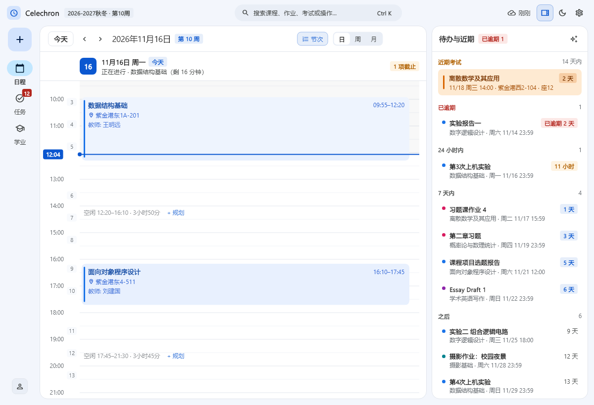

# Celechron 桌面版

**浙大課表、成績、考試、學在浙大作業，在電腦上一個視窗看完。**

這是 [Celechron](https://github.com/Celechron/Celechron) 的非官方桌面版（Windows / macOS）：登入與資料抓取沿用原版，桌面前端以 Material 3 與 Google Workspace 資訊架構從零重構，嚴格依真實時間比例排布日程。

**[⬇ 前往最新 Release](../../releases/latest)** · [Windows 安裝包 (`.exe`)](https://github.com/8eoyw/Celechron/releases/latest/download/Celechron-Setup-x64.exe) · [Windows 可攜版 (`.zip`)](https://github.com/8eoyw/Celechron/releases/latest/download/Celechron-Windows-x64.zip) · [macOS (`.dmg`)](https://github.com/8eoyw/Celechron/releases/latest/download/Celechron-macOS.dmg)

<picture>
  <source media="(prefers-color-scheme: dark)" srcset="docs/screenshots/overview-dark.png">
  
</picture>

<sub>截圖中的課程、成績、考試與作業皆為虛構的示範資料。</sub>

## 下載即用

到 [Releases](../../releases/latest) 或點擊上方直連下載對應系統的檔案，開啟後使用統一身分認證（ZJUAM）學號與密碼登入，課表、成績、考試與作業會自動同步。

### Windows

下載 **[`Celechron-Setup-x64.exe`](https://github.com/8eoyw/Celechron/releases/latest/download/Celechron-Setup-x64.exe)**，雙擊安裝。不需要管理員權限，也不必另裝 VC++ 執行期元件。

> 首次執行若跳出「Windows 已保護您的電腦」，點 **其他資訊 → 仍要執行**。這是因為程式沒有付費程式碼簽章，原始碼皆公開在本儲存庫。
>
> 不想安裝？可下載 [`Celechron-Windows-x64.zip`](https://github.com/8eoyw/Celechron/releases/latest/download/Celechron-Windows-x64.zip)，**先解壓縮**再執行裡面的 `Celechron.exe`。

### macOS

下載 **[`Celechron-macOS.dmg`](https://github.com/8eoyw/Celechron/releases/latest/download/Celechron-macOS.dmg)**（或可攜版 [`Celechron-macOS.zip`](https://github.com/8eoyw/Celechron/releases/latest/download/Celechron-macOS.zip)），開啟後將 Celechron 拖入「應用程式」資料夾。同一個檔案同時支援 Intel 與 Apple 晶片。

程式沒有 Apple 付費簽章，首次開啟會被系統攔截：

1. 雙擊開啟一次，出現「無法開啟」提示後點「完成」；
2. 開啟「系統設定 → 隱私權與安全性」，捲到底部點 Celechron 旁的 **「強制開啟」** 並輸入密碼確認。

若提示「已損毀，無法開啟」，在「終端機」執行以下指令移除隔離屬性後再開啟：

```bash
xattr -cr /Applications/Celechron.app
```

## 介面一覽（v4 架構）

桌面版採用極簡三工作區導覽（**日程 / 任務 / 學業**）＋ **右側協作面板** ＋ **`Ctrl+K` 全域指令搜尋**：

- **日程（日 / 週 / 月）**：所有課塊、考試、自建日程與規劃區塊皆以統一線性比例尺（`px/min`）繪製，不壓縮午休；左側同步顯示鐘點與浙大 1–13 節次刻度，寬螢幕自動並排顯示今日與明日，空檔可一鍵 `+ 规划` 或雙擊建立。
- **跨模組課程詳情**：點擊任一課程塊，右側協作面板原地切為「課程詳情」，整合教師、學分、本學期課時進度、關聯作業與期末考座位號。
- **任務與作業**：整合學在浙大作業、個人截止任務、固定重複日程與自動規劃；停留在此頁時右側面板自動切換為「今日日程與近期考試」避免重複。
- **學業中心**：共用學期切換器，整合考試倒數、GPA 與成績表（支援一鍵隱藏績點）以及 16 週課量分布圖。

## 快捷鍵

| 操作 | 快捷鍵 |
|---|---|
| 全域搜尋與指令面板 | `Ctrl` + `K`（macOS 為 `⌘` + `K`） |
| 展開 / 收起右側協作面板 | `Ctrl` + `\`（macOS 為 `⌘` + `\`） |
| 切換工作區（日程 / 任務 / 學業） | `Ctrl` + `1` ~ `3`（macOS 為 `⌘` + `1` ~ `3`） |
| 回到今天 / 新建任務 | `T` / `N` |
| 立即同步資料 | `Ctrl` + `R`（macOS 為 `⌘` + `R`） |
| 返回待辦 / 關閉彈窗 | `Esc` |

## 授權條款

[GPL-3.0](LICENSE)，與官方 Celechron 相同。
